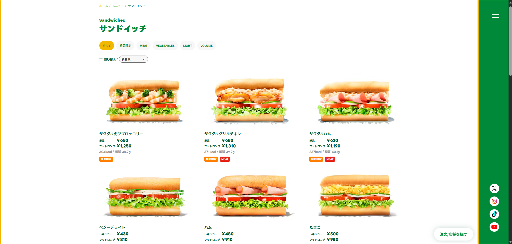

# サブウェイ画面拡大Chrome拡張

## 概要

サブウェイのWebページをPCで見た場合の見やすさを改善するChrome拡張です。

コードはAIにより生成しております。

サブウェイのWebページの更新により動作しなくなる可能性があります。

<table>
  <tr>
    <td align="center" width="50%">
      <b>使わない場合</b> 
      
    </td>
    <td>→</td>
    <td align="center" width="50%">
      <b>使った場合</b> 
      
    </td>
  </tr>
</table>

## インストール手順

1. このリポジトリのコードを自身の端末にダウンロードする
2. Google Chrome を開く
3. アドレスバーに chrome://extensions/ と入力してエンターキーを押す
4. 画面右上にある 「デベロッパー モード」 のスイッチを ON にする
5. 画面左上に出現する 「パッケージ化されていない拡張機能を読み込む」 ボタンをクリックする
6. 手順1でダウンロードしたファイルのうち、manifest.jsonが入っているフォルダを選択する（zipでダウンロードした場合は解凍しておく）
7. enjoy
